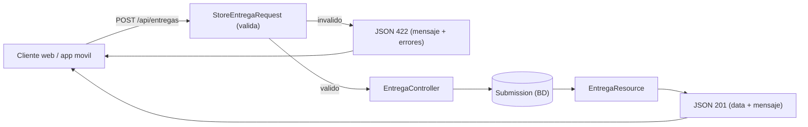
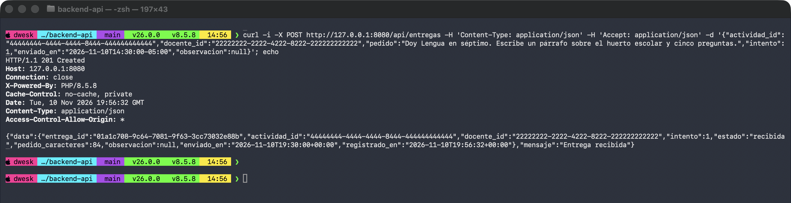
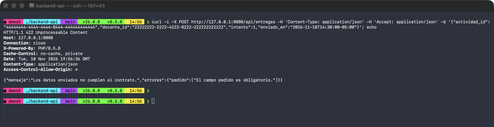
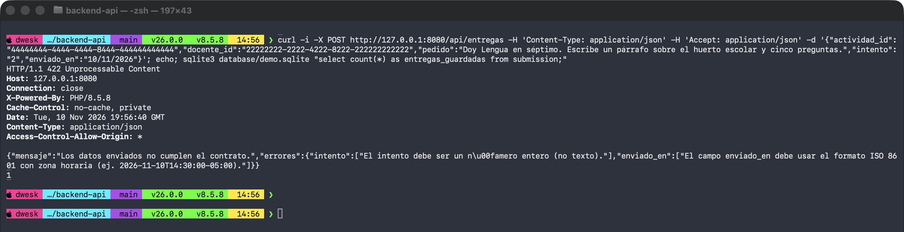
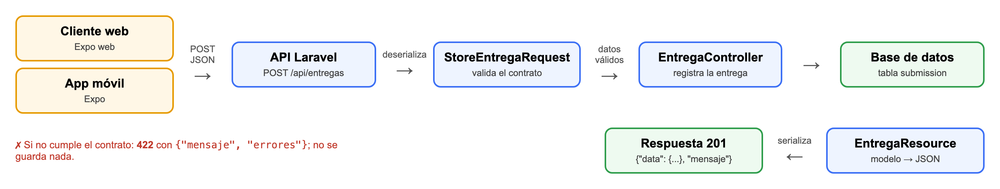

# Practica IS-803 - Tema 2.2: Capa de intercambio de informacion semantica

**Estudiante:** Luis Figueroa  
**Dominio:** ILIA (plataforma de formacion docente) - proceso «Entregar un taller».  
**Modulo individual:** sufijo `LuisFigueroa` (requests, resources, controlador, pruebas y seeder).

## a. Como ejecutar

```bash
php artisan migrate
php artisan db:seed --class=LuisFigueroaDemoSeeder   # imprime los UUID fijos
php artisan serve                                     # http://127.0.0.1:8000
php artisan test --filter=EntregaContrato
```

UUID fijos del seeder (usados en la coleccion de Postman):

| Entidad | UUID |
|---|---|
| instructor | `11111111-1111-4111-8111-111111111111` |
| docente | `22222222-2222-4222-8222-222222222222` |
| curso | `33333333-3333-4333-8333-333333333333` |
| actividad | `44444444-4444-4444-8444-444444444444` |

## b. Actividad 1: proceso, actores y endpoint

**Proceso:** un docente entrega el pedido (prompt) que redacto para la actividad de un taller. La API valida el contrato, registra la entrega con estado `recibida` y devuelve un JSON estructurado.

**Actores:** docente; cliente web/movil; API (Laravel); base de datos.

**Endpoints:** `POST /api/entregas` (crear) y `GET /api/entregas/{id}` (consultar).

## c. Contratos

### Solicitud (`POST /api/entregas`)

| Campo | Tipo | Obligatorio | Significado |
|---|---|---|---|
| `actividad_id` | string (UUID) | Si | Actividad del taller; debe existir. |
| `docente_id` | string (UUID) | Si | Docente que entrega; debe existir. |
| `pedido` | string (20-4000) | Si | Texto del prompt redactado. |
| `intento` | entero JSON (1-3) | Si | Numero de intento; no se acepta como texto. Unico por actividad+docente y no mayor al maximo de la actividad. |
| `enviado_en` | string ISO 8601 con zona | Si | Momento del envio en el cliente, ej. `2026-11-10T14:30:00-05:00`. |
| `observacion` | string (max 500) o null | No | Comentario opcional del docente. |

### Respuesta exitosa (201 / 200)

| Campo | Tipo | Obligatorio | Significado |
|---|---|---|---|
| `data.entrega_id` | string (UUID) | Si | Identificador de la entrega. |
| `data.actividad_id` | string (UUID) | Si | Actividad asociada. |
| `data.docente_id` | string (UUID) | Si | Docente que entrego. |
| `data.intento` | entero | Si | Intento registrado. |
| `data.estado` | string | Si | Siempre `recibida` en esta version. |
| `data.pedido_caracteres` | entero | Si | Longitud del pedido (no se devuelve el texto). |
| `data.observacion` | string o null | Si | Observacion, o `null` si no hubo. |
| `data.enviado_en` | string ISO 8601 | Si | Instante de envio (normalizado a UTC). |
| `data.registrado_en` | string ISO 8601 | Si | Instante en que el servidor registro la entrega. |
| `mensaje` | string | Si | `Entrega recibida`. |

### Respuesta de error

422 (validacion):

```json
{
  "mensaje": "Los datos enviados no cumplen el contrato.",
  "errores": { "campo": ["mensaje en espanol"] }
}
```

404 (GET): `{"mensaje": "Entrega no encontrada"}`.

## d. Codigos HTTP

| Codigo | Uso |
|---|---|
| 201 Created | Entrega registrada. |
| 200 OK | Consulta de una entrega existente. |
| 404 Not Found | El `id` consultado no existe. |
| 422 Unprocessable Content | El JSON es sintacticamente valido pero incumple el contrato. |

**Por que 422 y no 400:** 400 indica una peticion malformada (por ejemplo JSON roto). Aqui el JSON se entiende bien; lo que falla son las reglas semanticas (campo faltante, tipo erroneo, intento repetido). 422 expresa esa diferencia y es el estandar de Laravel para validacion.

## e. Serializacion y deserializacion

**Deserializacion (JSON -> PHP).** Laravel decodifica el cuerpo JSON en el `StoreEntregaRequest`. Tras validar, `$request->validated()` en `EntregaController::store` devuelve un array con solo los campos del contrato (nombres en espanol). El controlador lo mapea a columnas en ingles (`actividad_id` -> `activity_id`, `pedido` -> `prompt`, etc.). Aqui `intento:strict` evita que `"2"` se convierta silenciosamente en entero.

**Serializacion (modelo -> JSON).** `Submission::create(...)` guarda la fila. Los *casts* del modelo (`attempt` integer, `sent_at` y `created_at` datetime) convierten los valores de la BD en tipos PHP. Luego `EntregaResource::toArray()` construye el contrato de salida (columnas en ingles -> campos en espanol, fechas con `toIso8601String()`, `pedido_caracteres` calculado) y Laravel lo codifica a JSON bajo la clave `data`; `with()` anade `mensaje`.

```text
JSON body -> StoreEntregaRequest -> validated() [array] -> Submission::create (casts)
Submission -> EntregaResource::toArray() -> {"data": {...}, "mensaje": ...}
```

## f. Campos que se malinterpretarian sin documentacion

- **Fechas sin zona horaria:** `2026-11-10T14:30:00` no dice a que zona pertenece; el contrato exige offset (`-05:00`) y la API normaliza a UTC.
- **`intento` como texto:** `"2"` y `2` parecen iguales, pero el contrato exige entero JSON.
- **IDs numericos vs UUID:** otros endpoints del proyecto usan `id: 1`; este modulo usa UUID.
- **`observacion` null vs `""`:** `null` significa «sin observacion»; una cadena vacia es un valor distinto. La API conserva lo recibido.
- **Nombres en espanol vs columnas en ingles:** el contrato usa `pedido`, `docente_id`; la BD usa `prompt`, `user_id`. El mapeo vive solo en el controlador y el resource.

## g. Diagrama



## h. Evidencias

Capturas que debe tomar el estudiante en Postman (coleccion `postman_collection.json`, `base_url` = `http://127.0.0.1:8000`):

1. **P1:** peticion valida con respuesta `201` y el JSON de `data`.
2. **P2:** peticion sin `pedido` con respuesta `422` y `errores.pedido`.
3. **P3:** peticion con `intento: "dos"` y `enviado_en: "10/11/2026"` con respuesta `422`.

## Reflexion individual

> Pendiente: la redacta el estudiante.

1. Que campo del contrato fue mas facil de malinterpretar y por que?
2. Que habria pasado en el cliente movil si la API no hubiera validado el tipo de `intento`?
3. Que cambiarias del contrato para una segunda version?

## Capturas

Pruebas ejecutadas con curl contra `php artisan serve --port=8080`.







## Diagrama


