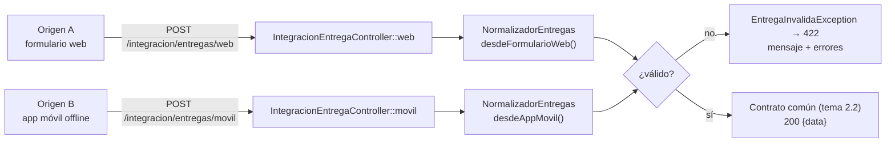
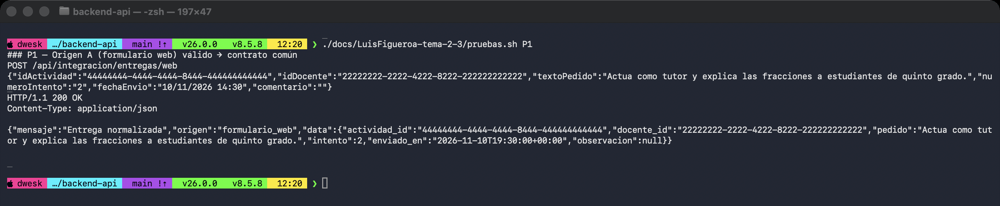
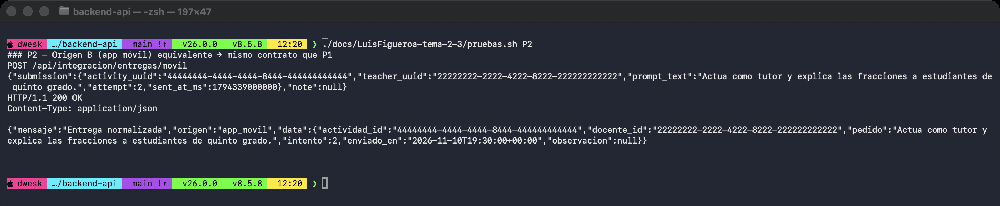
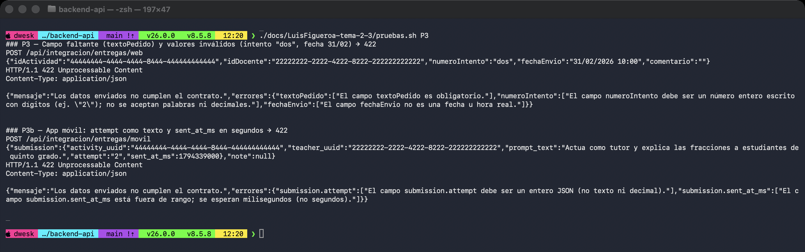
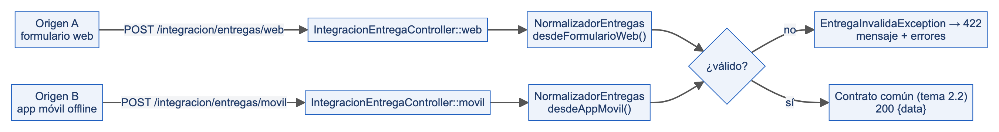

# Práctica IS-803 · Tema 2.3: Patrones de traducción y normalización

**Estudiante:** Luis Figueroa  
**Dominio:** ILIA (plataforma de formación docente), proceso «Entregar un taller».  
**Módulo individual:** sufijo `LuisFigueroa`.

## a. Cómo ejecutar

```bash
php artisan migrate
php artisan db:seed --class=LuisFigueroaDemoSeeder
php artisan serve --port=8080
docs/LuisFigueroa-tema-2-3/pruebas.sh          # todos los casos (P1, P2, P3)
docs/LuisFigueroa-tema-2-3/pruebas.sh P2       # un solo caso
docs/LuisFigueroa-tema-2-3/pruebas.sh EQ       # compara el `data` de P1 y P2
php artisan test --filter=Normaliza            # pruebas unitarias y de feature
```

## b. Problema

Dos clientes representan la misma «entrega» de forma distinta. El contrato común es el del tema 2.2 y **no se modifica**:
`actividad_id`, `docente_id`, `pedido`, `intento` (entero), `enviado_en` (ISO 8601 con offset), `observacion` (`null` o texto).

## c. Tabla de mapeo

| Origen A (formulario web, Expo) | Origen B (app móvil, sincronización offline) | Contrato común | Regla |
|---|---|---|---|
| `idActividad` | `submission.activity_uuid` | `actividad_id` | UUID válido; se normaliza a minúsculas. Obligatorio. |
| `idDocente` | `submission.teacher_uuid` | `docente_id` | UUID válido; se normaliza a minúsculas. Obligatorio. |
| `textoPedido` | `submission.prompt_text` | `pedido` | Texto de 20 a 4000 caracteres, sin espacios sobrantes en los extremos. |
| `numeroIntento` (texto, ej. `"2"`) | `submission.attempt` (entero JSON) | `intento` (entero) | A: solo dígitos (`"dos"`, `"2.5"`, `"-1"` se rechazan). B: debe ser entero JSON (`"2"` se rechaza). Rango 1 a 3. |
| `fechaEnvio` (`dd/mm/aaaa HH:mm`, hora de Ecuador) | `submission.sent_at_ms` (milisegundos epoch, UTC) | `enviado_en` (ISO 8601) | A: se interpreta en `America/Guayaquil` (UTC-5) y se convierte a UTC; se rechazan fechas inexistentes (31/02). B: se exige entero entre los años 2000 y 2100 (detecta segundos enviados como milisegundos). Salida canónica en UTC con precisión de segundos: `2026-11-10T19:30:00+00:00`. |
| `comentario` (`""` = sin comentario) | `note` (`null` = sin comentario) | `observacion` (`null` o texto) | `null`, `""` y texto en blanco → `null`. Máximo 500 caracteres. |

Ejemplo equivalente (ambos producen exactamente el mismo `data`):

```json
// Origen A
{"idActividad":"4444…","idDocente":"2222…","textoPedido":"Actua como tutor…","numeroIntento":"2","fechaEnvio":"10/11/2026 14:30","comentario":""}
// Origen B
{"submission":{"activity_uuid":"4444…","teacher_uuid":"2222…","prompt_text":"Actua como tutor…","attempt":2,"sent_at_ms":1794339000000},"note":null}
// Contrato común
{"actividad_id":"4444…","docente_id":"2222…","pedido":"Actua como tutor…","intento":2,"enviado_en":"2026-11-10T19:30:00+00:00","observacion":null}
```

## d. Endpoints

| Método | Ruta | Origen | Respuesta |
|---|---|---|---|
| POST | `/api/integracion/entregas/web` | A | 200 `{"mensaje":"Entrega normalizada","origen":"formulario_web","data":{…contrato…}}` |
| POST | `/api/integracion/entregas/movil` | B | 200 `{"mensaje":"Entrega normalizada","origen":"app_movil","data":{…contrato…}}` |

Los endpoints solo traducen y devuelven el contrato; el registro se sigue haciendo con `POST /api/entregas` (tema 2.2), que recibe exactamente ese `data`.

### Errores (422)

Mismo formato que el tema 2.2. Las claves de `errores` son los nombres del **campo de origen** (`numeroIntento`, `submission.attempt`) para que cada cliente reconozca su propio campo:

```json
{"mensaje":"Los datos enviados no cumplen el contrato.","errores":{"numeroIntento":["El campo numeroIntento debe ser un número entero escrito con dígitos (ej. \"2\"); no se aceptan palabras ni decimales."]}}
```

Se reportan **todos** los errores encontrados en una sola respuesta. Nunca se corrige un valor inválido en silencio.

## e. Por qué la traducción vive en un servicio y no en los controladores

- **Una sola fuente de verdad.** Las reglas de mapeo están en `App\Services\LuisFigueroa\NormalizadorEntregas`; los controladores (`IntegracionEntregaController`) solo entregan el cuerpo y envuelven el resultado.
- **Testeable sin HTTP.** El servicio se prueba con una prueba unitaria pura (sin base de datos ni servidor), que compara los arreglos de A y B.
- **Un tercer origen no toca la API.** Agregar un cliente nuevo implica un método nuevo en el traductor; el contrato común y sus consumidores no cambian (patrón *Message Translator* / *Canonical Data Model*).
- **Reutilizable.** La misma clase puede usarse desde un *job*, un comando o una cola (tema 3.x) sin depender de `Request`.



## f. Casos de prueba

| Caso | Entrada | Resultado esperado |
|---|---|---|
| P1 | Formulario web válido (`numeroIntento:"2"`, `fechaEnvio:"10/11/2026 14:30"`, `comentario:""`) | 200; `intento` = 2 (entero), `enviado_en` = `2026-11-10T19:30:00+00:00`, `observacion` = `null` |
| P2 | App móvil equivalente (`attempt:2`, `sent_at_ms:1794339000000`, `note:null`) | 200; `data` idéntico al de P1 |
| P3 | Web sin `textoPedido`, con `numeroIntento:"dos"` y `fechaEnvio:"31/02/2026 10:00"` | 422 con un error por campo |
| P3b | Móvil con `attempt:"2"` y `sent_at_ms` en segundos | 422 con `submission.attempt` y `submission.sent_at_ms` |

Pruebas automatizadas: `tests/Unit/LuisFigueroa/NormalizadorEntregasTest.php` (A y B producen el mismo arreglo, intentos ambiguos, fechas inválidas, campos faltantes) y `tests/Feature/LuisFigueroa/NormalizacionEntregasTest.php` (P1, P2, P3).

## g. Decisiones y límites

- La precisión de `enviado_en` es de segundos (el contrato 2.2 usa `Y-m-d\TH:i:sP`); los milisegundos de B se descartan de forma documentada, no aleatoria.
- Los campos desconocidos en el cuerpo se ignoran; solo se leen los campos de la tabla de mapeo.
- La existencia de `actividad_id` y `docente_id` en la base de datos **no** se valida aquí: eso pertenece al registro (`POST /api/entregas`).

## Capturas

Pruebas ejecutadas en la terminal contra `php artisan serve --port=8080` (base SQLite de demostración).








## Diagrama


