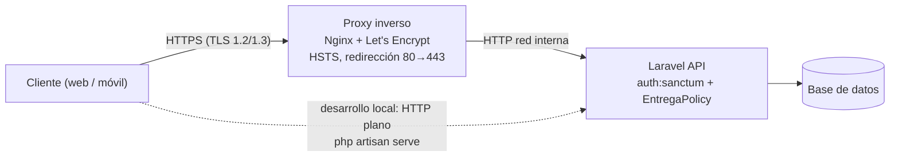

# Práctica IS-803 · Tema 2.4: Seguridad de la información en tránsito

**Estudiante:** Luis Figueroa  
**Dominio:** ILIA (plataforma de formación docente), proceso «Entregar un taller».  
**Módulo individual:** sufijo `LuisFigueroa`.

## a. Cómo ejecutar

```bash
cp .env.example .env && php artisan key:generate   # solo si aún no existe .env
php artisan migrate
php artisan db:seed --class=LuisFigueroaDemoSeeder  # requiere LUISFIGUEROA_DEMO_PASSWORD en .env
php artisan serve --port=8080                       # HTTP plano, solo desarrollo local
docs/LuisFigueroa-tema-2-4/pruebas.sh               # P1..P4 (o: pruebas.sh P3)
php artisan test --filter=Seguridad
```

Cuentas demo (contraseña ficticia en `LUISFIGUEROA_DEMO_PASSWORD`, nunca en el código):

| Cuenta | Rol en BD | Rol en la API | UUID |
|---|---|---|---|
| `docente.demo@ilia.test` | `teacher` | docente | `2222…2222` |
| `docente2.demo@ilia.test` | `teacher` | docente | `5555…5555` |
| `instructor.demo@ilia.test` | `instructor` | admin | `1111…1111` |

## b. Autenticación: tokens Bearer con Laravel Sanctum

- `POST /api/auth/token` recibe `{"email","password"}` y devuelve `access_token` (Bearer), `expira_en` y el rol. El token caduca según `LUISFIGUEROA_TOKEN_TTL_MINUTES` (120 por defecto). La ruta tiene límite de 10 intentos por minuto.
- `POST /api/auth/logout` revoca el token usado (se borra de `personal_access_tokens`).
- Credenciales incorrectas, usuario inexistente o inactivo responden lo mismo (`401 {"mensaje":"Credenciales inválidas."}`) para no revelar qué cuentas existen.
- Sanctum guarda solo el *hash* SHA-256 del token; el texto plano se muestra una única vez en la respuesta del login.

**Decisiones sobre el modelo de usuario**

- La tabla `app_user` ya tenía la columna `role` (`teacher` / `instructor`), por lo que **no se agregó otra columna**: `teacher` = docente e `instructor` = administrador. Es la opción más limpia y evita dos fuentes de verdad para el rol.
- `AppUser` ahora extiende `Authenticatable` y usa `HasApiTokens`; `getAuthPassword()` devuelve `password_hash` (la columna no se llama `password`) y `password_hash` está en `$hidden`.
- Migración `2026_11_12_000001`: la tabla de Sanctum usaba `morphs` (bigint), pero `app_user` usa UUID; se recrea con `uuidMorphs`.

## c. Autorización: `EntregaPolicy`

Registrada en `AppServiceProvider` (`Gate::policy(Submission::class, EntregaPolicy::class)`). La regla «el docente solo entrega a su nombre» se evalúa en `StoreEntregaRequest::authorize()`, por lo que el 403 se produce **antes** de la validación del contenido.

### Matriz de acceso

| Endpoint | Método | Público | Docente | Admin |
|---|---|---|---|---|
| `/api/auth/token` | POST | Sí (limitado a 10/min) | — | — |
| `/api/auth/logout` | POST | No (401) | Sí | Sí |
| `/api/entregas` | GET | No (401) | Solo las propias | Todas |
| `/api/entregas/{id}` | GET | No (401) | Solo si es suya (si no, 403) | Cualquiera |
| `/api/entregas` | POST | No (401) | Solo con `docente_id` propio (si no, 403) | Para cualquier docente |
| `/api/entregas/{id}` | DELETE | No (401) | No (403) | Sí |
| `/api/integracion/entregas/web` y `/movil` (tema 2.3) | POST | Sí: solo traducen, no leen ni escriben datos | — | — |

### Formato de errores

```json
// 401: sin token, token inválido, vencido o revocado
{"mensaje": "No autenticado."}
// 403: autenticado, sin permiso
{"mensaje": "No tiene permiso para esta acción."}
```

Los mensajes nunca repiten el token ni la contraseña recibidos. Las respuestas de la API incluyen `X-Content-Type-Options: nosniff` y `Cache-Control: no-store` (middleware `CabecerasSeguridad`); en producción añaden también `Strict-Transport-Security`.

## d. Secretos y registros (logs)

- `.env` está en `.gitignore`; solo `.env.example` (con valores ficticios) está versionado. Para ello se añadió `!.env.example` al `.gitignore`, porque la regla `.env.*` lo ocultaba.
- La contraseña de las cuentas demo viene de `config/luisfigueroa.php` → `LUISFIGUEROA_DEMO_PASSWORD`; el seeder falla con un mensaje claro si la variable no existe.
- El código no escribe contraseñas ni tokens en logs (ninguna llamada a `Log::` los menciona; se verifica en P4). Laravel no registra cabeceras ni cuerpos de petición por defecto.

### Variables de entorno usadas

Solo nombres (los valores viven en `.env`, fuera del repositorio):

| Grupo | Variables |
|---|---|
| Aplicación | `APP_NAME`, `APP_ENV`, `APP_KEY`, `APP_DEBUG`, `APP_URL` |
| Base de datos | `DB_CONNECTION`, `DB_HOST`, `DB_PORT`, `DB_DATABASE`, `DB_USERNAME`, `DB_PASSWORD` |
| Sesión, caché y colas | `SESSION_DRIVER`, `CACHE_STORE`, `QUEUE_CONNECTION` |
| Registros | `LOG_CHANNEL`, `LOG_STACK`, `LOG_LEVEL` |
| Módulo Luis Figueroa | `LUISFIGUEROA_DEMO_PASSWORD`, `LUISFIGUEROA_TOKEN_TTL_MINUTES` |
| Servicios opcionales | `MAIL_*`, `REDIS_*`, `AWS_*`, `SANCTUM_STATEFUL_DOMAINS` |

## e. HTTPS / TLS: qué se hace y qué no

**Honestidad sobre el entorno local.** `php artisan serve` atiende **HTTP plano** (`http://127.0.0.1:8080`). Allí el token Bearer viaja sin cifrar por la interfaz de loopback; es aceptable únicamente en desarrollo, sin tráfico de red real. **Esta práctica no activa TLS localmente.**

**Qué protege TLS.** HTTPS cifra el canal cliente-servidor: sin él, cualquiera en la ruta (Wi-Fi público, proxy intermedio) puede leer el `Authorization: Bearer …`, la contraseña del login y los pedidos de los docentes, o modificarlos. La autenticación por token solo es segura si el canal está cifrado.

**Despliegue previsto.**

1. **Terminación TLS en un proxy inverso** (Nginx/Caddy) con certificado de Let's Encrypt (renovación automática con `certbot`), o el TLS gestionado de la plataforma (balanceador, Cloud Run, etc.). Laravel escucha en HTTP solo en la red interna.
2. Redirigir todo HTTP:80 → HTTPS:443 en el proxy; protocolos TLS 1.2 y 1.3.
3. **HSTS:** el middleware `CabecerasSeguridad` envía `Strict-Transport-Security: max-age=31536000; includeSubDomains` cuando `APP_ENV=production`, para que los navegadores no vuelvan a usar HTTP.
4. **`URL::forceScheme('https')`** en `AppServiceProvider::boot()` cuando la app corre en producción, para que los enlaces generados (por ejemplo `links` de paginación o URLs firmadas) usen `https` aunque el proxy hable HTTP con la app.
5. Confiar en las cabeceras `X-Forwarded-*` del proxy (`trustProxies`) para que `request()->isSecure()` sea correcto detrás del balanceador.



## f. Casos de prueba (`pruebas.sh`)

| Caso | Acción | Esperado |
|---|---|---|
| P1 | Login docente (token enmascarado); lista propia, ve su entrega, registra la suya; el admin elimina la creada | 200 / 200 / 200 / 201 / 200 |
| P2 | `GET /api/entregas`, `GET /api/entregas/{id}`, `POST /api/entregas` sin token y con token inválido | 401 `{"mensaje":"No autenticado."}` |
| P3 | Docente ve entrega de otro; docente hace `DELETE`; docente entrega a nombre del docente 2 | 403 `{"mensaje":"No tiene permiso para esta acción."}` |
| P4 | `git check-ignore -v .env`; `git ls-files \| rg '\.env'` (solo `.env.example`); nombres de variables de `.env.example`; `rg` de secretos literales y de logs de credenciales | `.env` ignorado; sin secretos; sin coincidencias |

Pruebas automatizadas: `tests/Feature/LuisFigueroa/SeguridadEntregasTest.php` (login, logout, P1, P2, P3, cabeceras). Las pruebas del tema 2.2 ahora usan `Sanctum::actingAs()`.

## g. Límites

- Sin rotación de tokens ni *refresh tokens*; el token vence a los `LUISFIGUEROA_TOKEN_TTL_MINUTES` y se emite uno nuevo con el login.
- No hay TLS en local (ver sección e); el cifrado en tránsito es una responsabilidad del despliegue.
- El listado de entregas devuelve como máximo 100 registros.
