# Práctica IS-803 · Tema 3.1: Infraestructura de comunicación asíncrona (RabbitMQ real)

**Estudiante:** Luis Figueroa  
**Dominio:** ILIA (plataforma de formación docente), proceso «Entregar un taller».  
**Módulo individual:** sufijo `LuisFigueroa`.

> Se usa un **broker RabbitMQ real** (`rabbitmq:3.13-management` en Docker) y la librería `php-amqplib`. No hay simulación del broker en la aplicación; solo las pruebas automatizadas usan un publicador falso.

## a. Proceso asíncrono elegido

Después de registrar una entrega, se ejecuta en segundo plano la **revisión automática del pedido**: una rúbrica determinista de 5 criterios (20 puntos cada uno): nivel/grado, materia/tema, tarea concreta, salida esperada y longitud mínima (80 caracteres). Devuelve un `puntaje` (0-100) y una `retroalimentacion` con lo que falta. Para que la diferencia entre síncrono y asíncrono sea visible, cada revisión incluye un **retardo fijo y documentado de 3 segundos** (`LUISFIGUEROA_REVISION_DELAY_SECONDS=3`) que representa el coste de una revisión real (por ejemplo, llamar a un modelo de lenguaje). Las pruebas automatizadas lo ponen en 0.

## b. Cómo ejecutar

```bash
# 1) Broker (usa las variables LUISFIGUEROA_RABBITMQ_* del .env)
docker compose -f docker-compose.luisfigueroa.yml up -d
docker compose -f docker-compose.luisfigueroa.yml ps          # debe decir (healthy)

# 2) Aplicación
php artisan migrate && php artisan db:seed --class=LuisFigueroaDemoSeeder
php artisan serve --port=8080                                 # terminal 1

# 3) Consumidor (terminal 2). Ctrl+C lo detiene de forma ordenada
php artisan luisfigueroa:consumir-revisiones

# 4) Evidencias (terminal 3)
docs/LuisFigueroa-tema-3-1/pruebas.sh          # P1, P2, P3, P4 y T
docs/LuisFigueroa-tema-3-1/pruebas.sh P4       # un caso
docs/LuisFigueroa-tema-3-1/pruebas.sh Q        # estado de la cola
php artisan test --filter="Revision|Manejador"
```

Cómo verificar que la cola existe:

- **Interfaz de gestión:** <http://localhost:15672> (usuario y contraseña ficticios: `LUISFIGUEROA_RABBITMQ_USER` / `LUISFIGUEROA_RABBITMQ_PASSWORD` de `.env.example`), pestaña *Queues* → `ilia.revisiones` (Durable, mensajes *Ready* / *Unacked*).
- **Terminal:** `docker exec luisfigueroa-rabbitmq rabbitmqctl list_queues name messages_ready messages_unacknowledged consumers`

## c. Endpoints (todos requieren `Authorization: Bearer`, tema 2.4)

| Método | Ruta | Respuesta |
|---|---|---|
| POST | `/api/revisiones` | **202 Accepted** `{"mensaje":"Revisión en cola","message_id","correlation_id","estado":"pendiente"}` (no dice que terminó) |
| POST | `/api/revisiones/sincronas` | **200** con `estado`, `puntaje`, `retroalimentacion` tras ~3 s (equivalente síncrono) |
| GET | `/api/revisiones/{correlation_id}` | 200 `{"data":{estado, puntaje, retroalimentacion, ...}}`; 404 si no existe; 403 si no es del solicitante (el admin ve todas) |

- Solicitud: `{"entrega_id": "<uuid de una entrega existente>"}`; 422 si falta, no es UUID o no existe; 403 si la entrega no es del usuario (reutiliza `EntregaPolicy`).
- **Correlación:** se acepta la cabecera `X-Correlation-ID` (8 a 64 caracteres `A-Za-z0-9._-`, para no meter texto libre en logs y colas); si falta o es sospechosa, se genera un UUID. Siempre se devuelve en la cabecera y en el cuerpo.
- Si RabbitMQ no está disponible: **503** `{"mensaje":"El servicio de mensajería no está disponible..."}` y no queda ninguna fila `pendiente` huérfana.

### Mensaje publicado en la cola `ilia.revisiones`

```json
{
  "message_id": "c579a282-e805-4659-853a-52cc4f1da43e",
  "correlation_id": "f5f70d25-2643-43f4-877c-41847a2a7468",
  "tipo": "entrega.revision_solicitada",
  "ocurrido_en": "2026-11-12T17:01:23Z",
  "payload": { "entrega_id": "66666666-6666-4666-8666-666666666666", "intento": 1 }
}
```

Publicación: cola **durable** (`durable=true`) y mensaje **persistente** (`delivery_mode=2`), por lo que sobreviven a un reinicio del broker (comprobado: se reinició el contenedor con 1 mensaje pendiente y siguió en la cola).

## d. Piezas

| Pieza | Archivo |
|---|---|
| Puerto del broker (interfaz) | `app/Services/LuisFigueroa/Mensajeria/PublicadorMensajes.php` |
| Implementación AMQP | `.../Mensajeria/PublicadorAmqp.php` (enlazada en `AppServiceProvider`) |
| Falso para pruebas | `tests/Support/PublicadorFalso.php` |
| Productor HTTP | `app/Http/Controllers/api/LuisFigueroa/RevisionController.php` |
| Rúbrica | `app/Services/LuisFigueroa/RevisorPedidos.php` |
| Ciclo de vida de una revisión | `.../ProcesadorRevisiones.php` (pendiente → procesando → completada \| fallida) |
| Lógica del consumidor (sin RabbitMQ) | `.../ManejadorRevisiones.php` |
| Consumidor | `php artisan luisfigueroa:consumir-revisiones` |
| Tabla | `revision` (`correlation_id`, `message_id`, `entrega_id`, `estado`, `puntaje`, `retroalimentacion`, `error`, fechas, `origen`) |
| Log dedicado | `storage/logs/luisfigueroa-revisiones.log` (productor y consumidor, con `correlation_id`) |

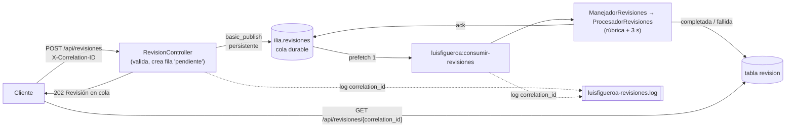

### Comportamiento del consumidor

- **Prefetch 1:** recibe un mensaje a la vez (en P1 se ve cómo los 3 mensajes se procesan uno tras otro, cada uno ~3 s).
- **Ack manual**, solo después de terminar el trabajo y guardar el resultado. Si el consumidor muere a mitad, el mensaje vuelve a la cola.
- **Mensaje malformado** (JSON roto, falta un campo, tipo desconocido): se registra en el log y se **rechaza sin reencolar** (`basic_reject requeue=false`); nunca podrá volverse válido.
- **Error de procesamiento** (p. ej. la entrega ya no existe): la fila queda `fallida` con su `error` y se hace **`nack` sin reencolar**. Decisión: reencolar un mensaje que siempre falla crearía un bucle infinito (*poison message*) que, con prefetch 1, bloquearía toda la cola. El fallo no se pierde: queda en la tabla y en el log con su `correlation_id`. En producción se añadiría un *dead-letter exchange* para revisarlo y reenviarlo.
- **Idempotencia:** si llega un duplicado (entrega *at-least-once*) de un mensaje ya `completada`, se confirma sin repetir el trabajo.

## e. Comparación síncrono vs asíncrono (medido)

Mediciones propias con `curl -w '%{time_total}'` (`pruebas.sh T`), retardo de revisión de 3 s, `php artisan serve` local:

| Criterio | Síncrono `POST /api/revisiones/sincronas` | Asíncrono `POST /api/revisiones` |
|---|---|---|
| Tiempo de respuesta inicial | **3,02 s** (3,021; 3,029; 3,029 / 3,023; 3,028; 3,024 en dos tandas) | **0,016 a 0,032 s** (202 Accepted) |
| Dependencia del consumidor | Ninguna: la propia petición hace el trabajo | Total para terminar la revisión; sin consumidor el mensaje espera en la cola |
| Comportamiento ante indisponibilidad | Si el servidor cae durante los 3 s, el cliente pierde el trabajo y debe reintentar | Si el consumidor está caído, el mensaje queda `pendiente` en la cola durable (P2) y se procesa al volver; si el **broker** cae responde 503 |
| Trazabilidad | Una sola petición/respuesta; `correlation_id` en log | `correlation_id` en cabecera, cola, log del productor, log del consumidor y tabla; estado consultable con `GET` |
| Resultado para el cliente | En la misma respuesta | Debe consultar `GET /api/revisiones/{correlation_id}` (o recibir una notificación) |

Conclusión: el modo asíncrono desacopla el tiempo de respuesta del coste del trabajo (≈ 100 veces más rápido para el cliente) a cambio de consistencia eventual y de operar un consumidor.

## f. Casos de prueba y evidencias (`pruebas.sh`)

| Caso | Qué hace | Esperado | Observado |
|---|---|---|---|
| P1 | 3 mensajes válidos con consumidor activo | 202 inmediato; filas `completada`; log con el mismo `correlation_id` | 202 ×3; 3 filas `completada` (puntaje 60); log productor→consumidor |
| P2 | Consumidor detenido → 1 mensaje; después se inicia el consumidor | Cola con `messages_ready=1`, estado `pendiente`; luego `0` y `completada` | `ilia.revisiones 1 0 0` → `0 0 1`; procesado 11 s después (también tras reiniciar el broker) |
| P3 | Sin `entrega_id`, no UUID, inexistente; y un mensaje malformado puesto directo en la cola | 422 ×3 sin cambiar la cola; el consumidor rechaza el malformado | 422 ×3; log `consumer: mensaje malformado, rechazado`; cola en 0 |
| P4 | Un `X-Correlation-ID` propio de extremo a extremo | Mismo id en respuesta, log del productor, log del consumidor y tabla | Coincide en los cuatro lugares |
| T | 3 llamadas síncronas y 3 asíncronas | ~3 s vs milisegundos | Ver tabla de la sección e |

Pruebas automatizadas (publicador falso, sin RabbitMQ): `tests/Feature/LuisFigueroa/RevisionAsincronaTest.php` (202 y forma exacta del mensaje, correlación, 422, 401/403, 503, sincrónico, GET) y `tests/Unit/LuisFigueroa/ManejadorRevisionesTest.php` (ack, duplicado, rechazo de malformados, nack, rúbrica determinista).

## g. Dificultad encontrada y solución

**`php artisan test` borraba mi base de datos de demostración.** Para correr el servidor y el consumidor contra SQLite exporté `DB_CONNECTION`/`DB_DATABASE` en la terminal (el `.env` apunta a PostgreSQL). Después de cada ejecución de las pruebas, el login de las cuentas demo fallaba y la tabla `revision` aparecía vacía: `RefreshDatabase` estaba ejecutando `migrate:fresh` sobre `demo.sqlite`. La causa es que `phpunit.xml` declara `<env name="DB_DATABASE" value=":memory:">`, pero PHPUnit no sobrescribe una variable que ya existe en el entorno, y Laravel lee `$_SERVER` antes que `$_ENV`. **Solución:** añadir en `phpunit.xml` `<server name="DB_CONNECTION" … force="true"/>` y `<server name="DB_DATABASE" value=":memory:" force="true"/>`; con eso las pruebas siempre usan memoria sin importar el entorno de la terminal.

Una segunda sorpresa: en el log, `consumer: mensaje recibido` aparecía **antes** que `producer: mensaje publicado`, porque el consumidor es más rápido que el resto del método del productor tras `basic_publish`. Se añadió un registro `producer: publicando mensaje` **antes** de publicar, de modo que el orden causal se lee correctamente en el archivo.

## h. Límites

- Una conexión AMQP por publicación (sencillo; en carga alta convendría reutilizarla).
- Sin *dead-letter exchange* ni reintentos con *backoff*: los errores de procesamiento quedan registrados, no reenviados.
- El consumidor termina si se pierde la conexión (un supervisor como Supervisor/systemd debe reiniciarlo).

## Capturas

Pruebas ejecutadas en la terminal contra `php artisan serve --port=8080` (base SQLite de demostración y RabbitMQ real).

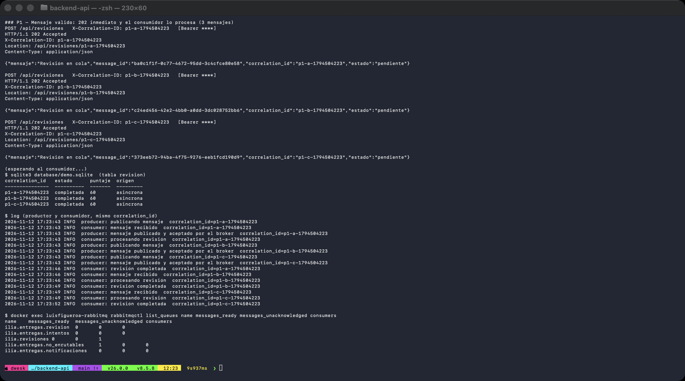

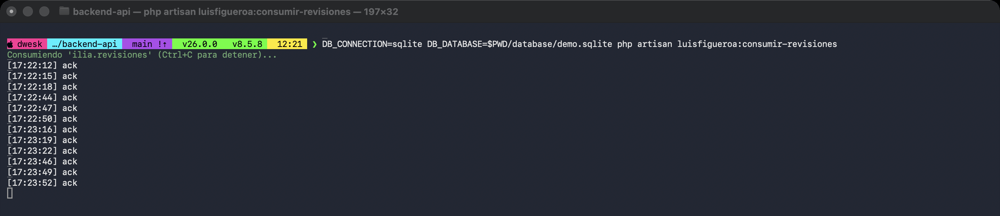

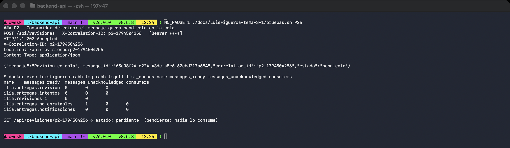

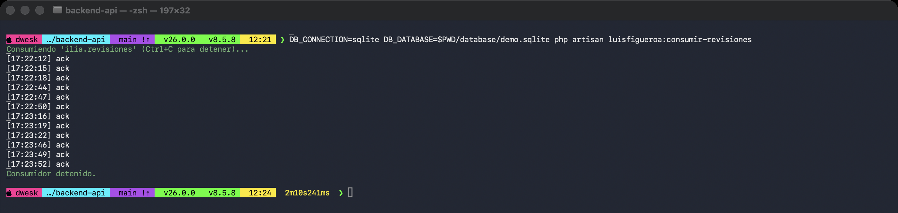

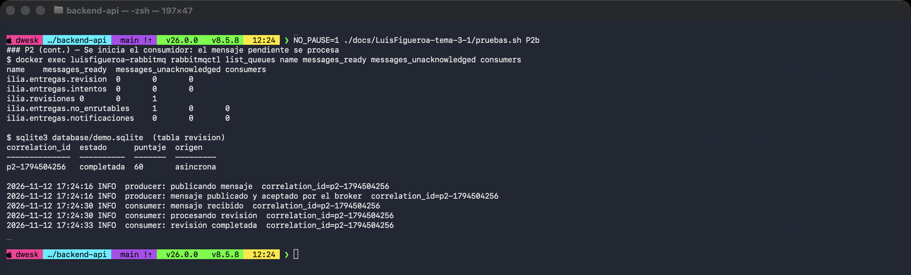

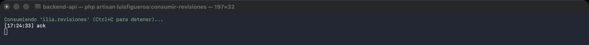

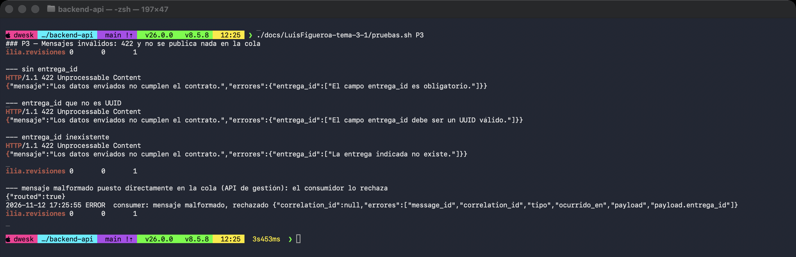

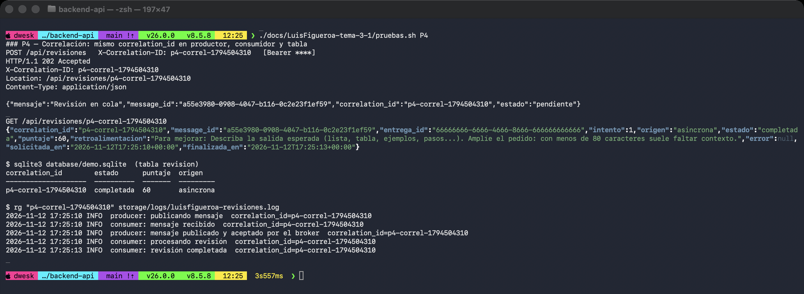

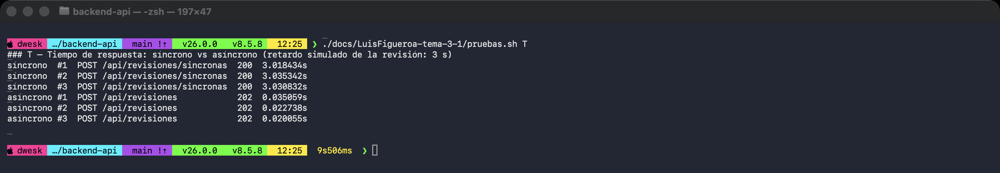

## Diagrama

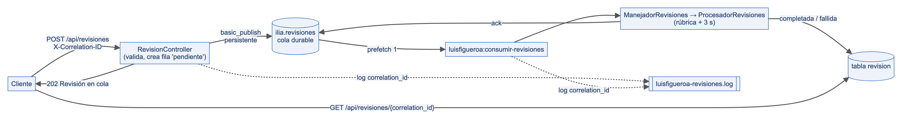
