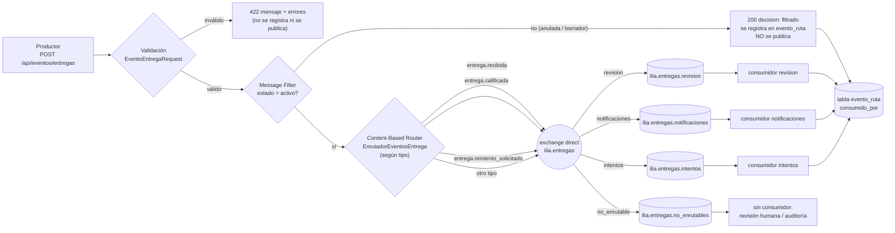

# Práctica IS-803 · Tema 3.2: Patrones de enrutamiento (Content-Based Router + Message Filter)

**Estudiante:** Luis Figueroa  
**Dominio:** ILIA (plataforma de formación docente), proceso «Entregar un taller».  
**Módulo individual:** sufijo `LuisFigueroa`.

> **Se usa un broker real: RabbitMQ 3.13** (contenedor `luisfigueroa-rabbitmq`, `docker-compose.luisfigueroa.yml`) con `php-amqplib`. El exchange, las colas, los *bindings*, los consumidores y los *acks* son los de RabbitMQ; nada del enrutamiento está simulado. Solo las pruebas automatizadas sustituyen el publicador por un falso.

## a. Cómo ejecutar

```bash
docker compose -f docker-compose.luisfigueroa.yml up -d          # broker (healthy)
php artisan migrate && php artisan db:seed --class=LuisFigueroaDemoSeeder
php artisan luisfigueroa:topologia-eventos                      # exchange + 4 colas (idempotente)
php artisan serve --port=8080                                   # terminal 1

# Un consumidor por destino (terminales 2, 3 y 4; Ctrl+C los detiene)
php artisan luisfigueroa:consumir-eventos --destino=revision
php artisan luisfigueroa:consumir-eventos --destino=notificaciones
php artisan luisfigueroa:consumir-eventos --destino=intentos

docs/LuisFigueroa-tema-3-2/pruebas.sh        # P1..P6 y resumen (o: pruebas.sh P5, Q, R)
php artisan test --filter="Enrutamiento|Enrutador|ManejadorEventos"
```

Verificación en el broker: <http://localhost:15672> → *Exchanges* → `ilia.entregas` → *Bindings*; o `docker exec luisfigueroa-rabbitmq rabbitmqctl list_queues name messages_ready messages_unacknowledged consumers`.

## b. Contrato del evento (`POST /api/eventos/entregas`)

Requiere `Authorization: Bearer` de un **admin/instructor** (los eventos los publican servicios internos; un docente recibe 403, sin token 401).

```json
{
  "id": "9ab90d2f-ce38-4e8c-b131-215065fff9a4",
  "correlation_id": "evt-9ab90d2f-corr",
  "tipo": "entrega.recibida",
  "prioridad": "alta",
  "estado": "activo",
  "datos": { "entrega_id": "66666666-6666-4666-8666-666666666666" }
}
```

| Campo | Obligatorio | Regla |
|---|---|---|
| `id` | Sí | UUID. Un `id` repetido responde 409 (idempotencia del productor). |
| `correlation_id` | No | 8 a 64 caracteres `A-Za-z0-9._-`; si falta se genera un UUID. |
| `tipo` | Sí | Texto; un tipo desconocido **no** es error de validación, va a `no_enrutables`. |
| `prioridad` | Sí | `alta` \| `media` \| `baja` |
| `estado` | Sí | `activo` \| `anulada` \| `borrador` (estado de la entrega) |
| `datos.entrega_id` | Sí | UUID; `datos` puede traer más campos. |

## c. Pipeline y diagrama



## d. Reglas del enrutador (explícitas, en `EnrutadorEventosEntrega::REGLAS`)

| Condición (`tipo`) | Destino (cola) | Routing key | Justificación |
|---|---|---|---|
| `entrega.recibida` | `ilia.entregas.revision` | `revision` | Una entrega recién registrada debe pasar por la revisión automática del pedido. |
| `entrega.calificada` | `ilia.entregas.notificaciones` | `notificaciones` | Hay que avisar al docente de su calificación; es trabajo distinto y con otro ritmo. |
| `entrega.reintento_solicitado` | `ilia.entregas.intentos` | `intentos` | Habilitar un nuevo intento modifica el estado de la actividad y debe procesarse aparte. |
| cualquier otro | `ilia.entregas.no_enrutables` | `no_enrutable` | Ningún consumidor sabe qué hacer con él: se aparta en lugar de descartarlo. |

**Prioridad (opcional, implementada):** `alta` = 9, `media` = 5, `baja` = 1 como *priority* AMQP del mensaje; las tres colas funcionales se declaran con `x-max-priority=10`, de modo que un evento `alta` adelanta a los `baja` que esperan en la misma cola.

### Topología real (la crea `php artisan luisfigueroa:topologia-eventos`, de forma idempotente)

| Elemento | Tipo | Detalle |
|---|---|---|
| `ilia.entregas` | exchange `direct`, durable | Enrutamiento exacto por routing key. |
| `ilia.entregas.revision` | cola durable | binding `revision`, `x-max-priority=10` |
| `ilia.entregas.notificaciones` | cola durable | binding `notificaciones`, `x-max-priority=10` |
| `ilia.entregas.intentos` | cola durable | binding `intentos`, `x-max-priority=10` |
| `ilia.entregas.no_enrutables` | cola durable | binding `no_enrutable` |

Los mensajes se publican persistentes (`delivery_mode=2`). Los consumidores no crean colas: si no existen, avisan que se ejecute el comando de topología.

## e. Message Filter: «filtrado» no es un fallo de transporte

La regla del filtro mira el **contenido** (`estado`): solo pasan eventos de entregas `activo`. Un evento de una entrega `anulada` o `borrador` se descarta *a propósito*:

- responde **200** `{"decision":"filtrado","motivo":"…"}` (no es un error del cliente ni del servidor);
- **no se publica** en RabbitMQ (las colas no cambian);
- queda registrado en `evento_ruta` con `decision = filtrado` y el motivo.

Esto es distinto de un fallo de transporte (**503**, el broker no responde; no se deja ninguna ruta registrada) y de un evento inválido (**422**, ni siquiera se registra porque no es un evento).

## f. Mensajes no reconocidos

Un `tipo` que ninguna regla conoce **no se pierde ni se rechaza**: el enrutador lo manda a `ilia.entregas.no_enrutables` con decisión `no_enrutable` y respuesta 202 (el sistema lo aceptó y lo apartó). Esa cola no tiene consumidor automático a propósito: es una bandeja de revisión para que una persona (o una herramienta de auditoría) decida si falta una regla o si el productor se equivocó. Así un tipo nuevo no hace caer a ningún consumidor ni desaparece en silencio. Además, cada consumidor verifica que el `tipo` del mensaje corresponda a su cola: si no (por ejemplo, alguien publicó a mano en la cola equivocada) lo marca `invalido` en `evento_ruta` y lo rechaza sin reencolar; lo mismo para JSON ilegible o con campos faltantes.

## g. Consumidores y registro

`php artisan luisfigueroa:consumir-eventos --destino=revision|notificaciones|intentos`: *prefetch 1*, *ack* manual tras registrar, `reject` sin reencolar para mensajes inválidos. Cada uno ejecuta su acción de negocio (aquí una línea de log, p. ej. «avisar al docente de la calificación») y actualiza `evento_ruta.consumido_por` / `consumido_en`.

`evento_ruta`: `evento_id`, `correlation_id`, `tipo`, `prioridad`, `estado_entrega`, `decision` (`enrutado` \| `filtrado` \| `no_enrutable` \| `invalido`), `destino`, `routing_key`, `motivo`, `consumido_por`, `recibido_en`, `consumido_en`. Log: `storage/logs/luisfigueroa-eventos.log`.

## h. Respuestas del endpoint

| Situación | HTTP | Cuerpo (resumen) |
|---|---|---|
| Enrutado | 202 | `decision: enrutado`, `destino`, `routing_key`, `prioridad_amqp` |
| Tipo desconocido | 202 | `decision: no_enrutable`, `destino: ilia.entregas.no_enrutables` |
| Filtrado | 200 | `decision: filtrado`, `motivo` |
| Contrato inválido | 422 | `{"mensaje":…,"errores":{campo:[…]}}` |
| `id` repetido | 409 | `Evento ya recibido (id duplicado).` |
| Broker caído / sin topología | 503 | `El servicio de mensajería no está disponible…` |

## i. Casos de prueba (`pruebas.sh`)

| Caso | Entrada | Observado |
|---|---|---|
| P1 | `entrega.recibida`, prioridad alta | 202 → `ilia.entregas.revision`; `consumido_por = revision` |
| P2 | `entrega.calificada` | 202 → `ilia.entregas.notificaciones`; `consumido_por = notificaciones` |
| P3 | `entrega.reintento_solicitado` | 202 → `ilia.entregas.intentos`; `consumido_por = intentos` |
| P4 | `entrega.tipo_inventado` | 202 `no_enrutable`; `ilia.entregas.no_enrutables` pasa a 1 mensaje listo y nadie lo consume |
| P5 | `estado: anulada` | 200 `filtrado`; las colas no cambian; fila `filtrado` sin `consumido_por` |
| P6 | Sin `prioridad` ni `datos` | 422 con un error por campo; 0 filas registradas |

Pruebas automatizadas: `tests/Feature/LuisFigueroa/EnrutamientoEventosTest.php` (los 6 casos con publicador falso, prioridad, correlación, 409, 503, 401/403), `tests/Unit/LuisFigueroa/EnrutadorEventosEntregaTest.php` (reglas y filtro) y `tests/Unit/LuisFigueroa/ManejadorEventosEntregaTest.php` (lógica del consumidor sin RabbitMQ).

## j. Límites

- El `estado` llega en el evento; no se consulta la entrega en la base de datos (el filtro actúa sobre el mensaje, como pide el patrón).
- `no_enrutables` no tiene consumidor ni *dead-letter*; crece hasta que alguien la revise.
- Sin reintentos ni *backoff* ante fallos del consumidor: el mensaje inválido se rechaza y se registra.
